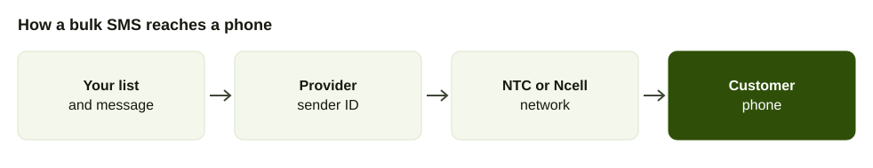
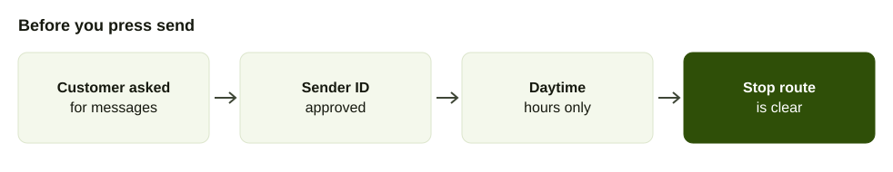

Bulk SMS is the oldest tool in a Nepali business's outreach kit, and the price list is the part that confuses people. Operators sell packs, resellers sell credits and everyone talks about a sender ID without saying what it is.

This guide uses only prices and rules from pages we opened in October 2026, and links each one. For messages that need to be heard rather than read, see [bulk voice calls in Nepal](/blog/bulk-voice-call-nepal).

## Three ways to buy bulk SMS in Nepal

1. **From an operator's group portal.** Nepal Telecom sells packs on a web portal. You buy, upload numbers and send. Good for occasional senders.
2. **From a registered SMS provider.** A company with its own agreement with the operators, which sells you credits and a panel or API. Good for regular senders and for business sender IDs.
3. **From an international gateway.** A global SMS API that routes to Nepal. Priced in US dollars and usually dearer per message.

## What bulk SMS costs: operator prices

All prices below are as published on the pages linked. Rows marked "ex tax" exclude tax and rows marked "incl tax" include it, exactly as each source states.

| Provider | Plan / service | What's included | Price per SMS | Source | Checked |
| --- | --- | --- | --- | --- | --- |
| Nepal Telecom, Group SMS | 2,000 SMS pack | Web portal, Excel upload, own SIM registered in your name | Rs 1,243 for 2,000, about Rs 0.62 incl tax | [Ratopati, 1 March 2026](https://english.ratopati.com/story/51125/telecoms-group-sms-service-messages-can-be-sent-to-up-to-10000-people-at-once) | Oct 2026 |
| Nepal Telecom, Group SMS | 5,000 SMS pack | Same | Rs 3,108 for 5,000, about Rs 0.62 incl tax | [Ratopati](https://english.ratopati.com/story/51125/telecoms-group-sms-service-messages-can-be-sent-to-up-to-10000-people-at-once) | Oct 2026 |
| Nepal Telecom, Group SMS | 10,000 SMS pack | Same | Rs 6,215 for 10,000, about Rs 0.62 incl tax | [Ratopati](https://english.ratopati.com/story/51125/telecoms-group-sms-service-messages-can-be-sent-to-up-to-10000-people-at-once) | Oct 2026 |
| Ncell, Mega SMS pack | 2,000 SMS, valid 2 days | Reaches all Nepali networks, any time | Rs 1,000, Rs 0.50 | [NepaliTelecom, June 2023](https://www.nepalitelecom.com/ncell-sms-pack) | Oct 2026 |
| Ncell, Mega SMS pack | 5,000 SMS, valid 5 days | Same | Rs 2,500, Rs 0.50 | [NepaliTelecom](https://www.nepalitelecom.com/ncell-sms-pack) | Oct 2026 |
| Ncell, Mega SMS pack | 10,000 SMS, valid 10 days | Same | Rs 5,000, Rs 0.50 | [NepaliTelecom](https://www.nepalitelecom.com/ncell-sms-pack) | Oct 2026 |
| Nepal Telecom, web-based bulk SMS (private company) | 2,000 to 100,000 SMS, valid 3 months | Alphanumeric sender code assigned | Rs 0.50 ex tax | [NTC](https://ntc.net.np/services/sms-based-vas-services) | Oct 2026 |
| Nepal Telecom, web-based bulk SMS (private company) | 100,001 to 500,000, valid 6 months | Same | Rs 0.40 ex tax | [NTC](https://ntc.net.np/services/sms-based-vas-services) | Oct 2026 |
| Nepal Telecom, web-based bulk SMS (private company) | 500,001 to 1,000,000, valid 9 months | Same | Rs 0.30 ex tax | [NTC](https://ntc.net.np/services/sms-based-vas-services) | Oct 2026 |
| Nepal Telecom, web-based bulk SMS (private company) | Above 1,000,000, valid 1 year | Same | Rs 0.20 ex tax | [NTC](https://ntc.net.np/services/sms-based-vas-services) | Oct 2026 |

Read the table carefully. The Ncell packs expire in days, so a campaign you cannot finish in the window wastes credit, and once a pack runs out Ncell charges its normal tariff, as the [NepaliTelecom report](https://www.nepalitelecom.com/ncell-sms-pack) notes. The NTC web-based tariff buys a quota valid for months, and you pay the whole slab in advance into a bank account named on [NTC's page](https://ntc.net.np/services/sms-based-vas-services).

### NTC's tariff for alert senders

Banks and companies that connect their own system send SMS alerts rather than web-based bulk. NTC lists a tariff for them by monthly volume, and a minimum of 3,000 messages a month is billed even if you send fewer, per [NTC](https://ntc.net.np/services/sms-based-vas-services).

| Monthly volume | Price per SMS ex tax |
| --- | --- |
| 3,000 to 100,000 | Rs 0.50 |
| 100,001 to 1,000,000 | Rs 0.40 |
| 1,000,001 to 3,000,000 | Rs 0.30 |
| Above 3,000,000 | Rs 0.20 |

A private company on this plan also lodges a deposit or bank guarantee. NTC's table shows a minimum of Rs 500,000 plus Rs 100,000 per alert ID. A small business will not use this route. It explains why a reseller can sell you SMS at all: the reseller is a company buying at these slabs.

## What resellers charge

Registered providers do not publish a full rate card. Here is what is public.

| Provider | Plan / service | What's included | Price | Source | Checked |
| --- | --- | --- | --- | --- | --- |
| Sparrow SMS | One-time SMS service | Pay-as-you-go use | Rs 2.50 plus VAT per SMS | [Sparrow FAQ](https://sparrowsms.com/faqs/) | Oct 2026 |
| Sparrow SMS | Year-end offer, 5,000 SMS plus 500 bonus | No annual charge, unlimited credit validity | Rs 4,750, about Rs 0.86 per SMS counting bonus | [Sparrow blog](https://sparrowsms.com/blog/affordable-bulk-sms-service-in-nepal/) | Oct 2026 |
| Sparrow SMS | Year-end offer, 15,000 plus 1,000 bonus | Same | Rs 12,750, about Rs 0.80 | [Sparrow blog](https://sparrowsms.com/blog/affordable-bulk-sms-service-in-nepal/) | Oct 2026 |
| Sparrow SMS | Year-end offer, 25,000 plus 1,250 bonus | Same | Rs 18,750, about Rs 0.72 | [Sparrow blog](https://sparrowsms.com/blog/affordable-bulk-sms-service-in-nepal/) | Oct 2026 |
| Aakash SMS, Telenet and 17 other providers | Not published | Listed by NTC as registered | Ask for a quote | [NTC provider list](https://ntc.net.np/services/sms-based-vas-services) | Oct 2026 |
| AirFone | Bulk SMS | On the same platform as calls | See the pricing page | [AirFone pricing](/pricing) | Oct 2026 |

The Sparrow offer is a seasonal promotion and the post date is not shown on the page, so treat the figures as an example of reseller pricing, not a current rate. [Sparrow's own pricing guide](https://sparrowsms.com/blog/bulk-sms-service-pricing/) says the price depends on the volume you buy and the sender ID type: more messages lower the unit price, and a dedicated sender ID costs extra. The per-message figures above are our division of the published pack price, not a rate the provider quotes.

## International gateways, in US dollars

Global SMS APIs also route to Nepal. Their published prices are far higher than the local ones.

| Provider | Route | Price per SMS | Source | Checked |
| --- | --- | --- | --- | --- |
| Twilio | Outbound to Nepal, alphanumeric sender ID or international number | $0.3082 | [Twilio](https://www.twilio.com/en-us/sms/pricing/np) | Oct 2026 |
| Plivo | Nepal Telecom | $0.2706 | [Plivo](https://www.plivo.com/sms/pricing/np/) | Oct 2026 |
| Plivo | Smart Telecom | $0.2546 | [Plivo](https://www.plivo.com/sms/pricing/np/) | Oct 2026 |
| Plivo | Default Nepal route | $0.6774 | [Plivo](https://www.plivo.com/sms/pricing/np/) | Oct 2026 |
| D7 Networks | Local or international | $0.3 | [D7 Networks](https://d7networks.com/sms/nepal/) | Oct 2026 |

At $0.27 to $0.31, one international message costs several times the Rs 0.50 to Rs 0.62 of the local routes. They suit developers who need an API and a foreign billing account. They do not suit a shop sending a festival offer.

## How to start directly with Nepal Telecom

NTC's page describes the route for web-based bulk SMS, which it calls most suitable for schools, colleges, business houses and SMEs, with a highly subsidised cost and no technical test, so it can start within a working day ([NTC](https://ntc.net.np/services/sms-based-vas-services)).

1. Write a formal request letter with your company profile, the purpose of the bulk SMS and your target customers.
2. Attach your company registration and tax registration copies.
3. Send it to NTC's VAS office at Bhadrakali, Kathmandu (email vas@ntc.net.np, phone 014210278 on the same page).
4. Sign the contract when NTC replies.
5. Pay the amount for your SMS quota into the bank account NTC lists.
6. NTC creates a user account and emails the portal login. You do not need a system of your own.

NTC's page says an Excel upload takes 1,000 numbers at a time, and prices on that page include applicable taxes in that line, while the tariff table above says excluding tax. The two statements sit on the same page, so ask NTC which applies to your slab before you pay.

For a one-off send from your own SIM, the Group SMS portal at groupsms.ntc.net.np sells the packs in the first table. NepaliTelecom's 2022 guide says an organisation wanting the service from NTC itself visits a Chief Commercial Office or regional directorate with a proposal and documents, and that individuals are directed to licensed providers such as Sparrow SMS, Aakash SMS and Telenet ([NepaliTelecom](https://www.nepalitelecom.com/2019/11/bulk-sms-service-ntc.html)).

## Who is allowed to send

The Telecom Act 2053 lets only licensed companies provide SMS termination, and the Nepal Telecommunications Authority warned in July 2025 that unlicensed bodies delivering SMS through licensed networks would face legal action, as [NepaliTelecom reported](https://www.nepalitelecom.com/2025/07/nta-warns-against-unauthorized-termination-of-international-a2p-sms-in-nepal.html). For a buyer, the practical meaning is simple: use a company that has an agreement with the operators.

NTC publishes a list of 19 SMS and USSD service providers on its [VAS page](https://ntc.net.np/services/sms-based-vas-services). It includes Aakash Tech, Janaki Technology, Karuna Technology, Telenet and others. Ask any reseller whether it is on that list before you pay.

## Sender IDs explained

A sender ID is the name that appears as the sender, such as a shop name instead of a mobile number. NTC says that for web-based bulk SMS an alphanumeric code is assigned to the client, and that SMS Alert uses an alert name in place of a numeric short code ([NTC](https://ntc.net.np/services/sms-based-vas-services)). Interactive services that accept replies use a numeric short code and, NTC says, need technical tests and NTA approval.

A gateway provider's guide states that dynamic sender IDs are allowed on all Nepali networks except Ncell, where the sender ID must be registered before use ([D7 Networks](https://d7networks.com/sms/nepal/sms-regulations/)). Registration takes time, so ask any provider how long it will be before your first send.

Choose a name customers recognise. Avoid a generic name, which the same D7 guide lists among its don'ts, and never imitate a bank or an office.

## The rules to follow

We did not find a single NTA directive covering commercial content. What exists is NTC's own terms and provider guidance, and a recent enforcement case. Follow these.

1. **You are responsible for the content.** NTC says the sender bears full responsibility for the words, sentiment and impact of a Group SMS, and requires a SIM registered in the user's own name ([Ratopati](https://english.ratopati.com/story/51125/telecoms-group-sms-service-messages-can-be-sent-to-up-to-10000-people-at-once)).
2. **Send only to people who opted in.** D7's best-practice list says to send only to users who opted in and to include a free opt-out.
3. **Avoid restricted content and hours.** The same list says no political, gambling or religious content, no messages to numbers on a do-not-disturb list and none during restricted hours. It does not state the hours.
4. **Register the sender ID.** The same guide says never to skip sender ID registration.
5. **Keep your consent record.** Write down where and when each number was collected, so you can answer a complaint.

### Why providers are strict

In January 2026 about six million political messages went out through Nepal Telecom's network under the sender IDs "AT Alert" and "SI Alert". The regulator said it was investigating, and the gateway company said it had no system to filter all content in real time, according to [The Kathmandu Post](https://kathmandupost.com/national/2026/01/14/bulk-sms-calling-for-royalist-protests-sparks-privacy-concerns). After a case like that, expect a reseller to ask who you are, what you will send and where the numbers came from.

## How many characters, and what you pay

An SMS is billed per part, and the part size depends on the alphabet. Sparrow's FAQ gives the limits: 160 characters for one English SMS and 153 per part when longer, but 70 characters for one Nepali Unicode SMS and 67 per part when longer. One Unicode character turns the whole message into Unicode ([Sparrow FAQ](https://sparrowsms.com/faqs/)). NepaliTelecom gives the same 140 and 70 character figures for NTC ([NepaliTelecom](https://www.nepalitelecom.com/2019/11/bulk-sms-service-ntc.html)), so check how your provider counts.

| Message | Characters | Parts billed |
| --- | --- | --- |
| English, up to 160 characters | 160 | 1 |
| English, 306 characters | 306 | 2 |
| Nepali, up to 70 characters | 70 | 1 |
| Nepali, 134 characters | 134 | 2 |
| Nepali, 201 characters | 201 | 3 |

Example calculation: a clinic reminds 600 patients. In English, one part each: 600 SMS. In Nepali at 134 characters, two parts each: 1,200 SMS. At NTC's Group SMS pack price of about Rs 0.62, that is about Rs 373 against Rs 745 a month. The same words cost twice as much in Devanagari, so write short.

## Writing a good bulk SMS

- **Start with who you are**, even with a sender ID.
- **One message, one action:** a date, a link or a number to call.
- **Plain words,** few capitals, no pressure.
- **Aim for one part,** especially in Devanagari.
- **Test first.** Send to five staff phones on both networks and read the result on the handset.

Example, 83 characters in English, one part: "Himal Dental: your appointment is tomorrow at 10 am. Call 01-XXXXXXX to change it."

## SMS or a call

SMS is right when people need to keep the information: a date, a code, an address. A call is better when the message is urgent or needs an answer. A school can call parents about a closure and text the new dates, as described in [automated calls to parents](/blog/school-automated-calls-parents). AirFone offers bulk SMS and smart bulk calls on one platform, so one list can serve both.

## How to choose a provider

1. Check the provider is on [NTC's list](https://ntc.net.np/services/sms-based-vas-services).
2. Ask for a written rate at your monthly volume, and whether tax is included.
3. Ask how long credits stay valid.
4. Ask how sender IDs are approved on NTC and Ncell, and how long it takes.
5. Ask whether you get a delivery report per number. Sparrow, for one, says you can export history and delivery reports from the panel ([Sparrow FAQ](https://sparrowsms.com/faqs/)).
6. Ask how opt-outs and complaints are handled.
7. Send a test to both NTC and Ncell numbers before buying a large pack.

If you also run a phone line, make sure your SMS name matches the name customers see on calls. [Choosing a business phone number](/blog/business-phone-number-nepal) covers keeping one number for both.

## Checklist

- Provider is registered and gives a written rate with tax stated.
- Sender ID is registered, and recognisable to customers.
- List contains only people who agreed to hear from you.
- Message fits one part, or you have budgeted the extra parts.
- Sending hours are daytime.
- Every message has a way to stop.
- You have tested on NTC and Ncell phones.
