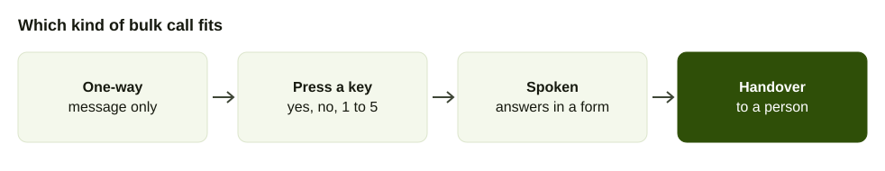
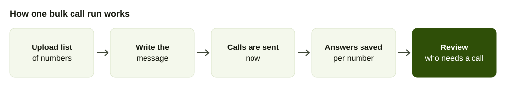

An SMS gets read hours later, or not at all. A phone call gets answered in the next ten seconds or declined. For a short, time-sensitive message, such as "your appointment is tomorrow at 10", that difference is the whole case for a bulk voice call.

This guide explains what bulk voice calls are, what is available in Nepal, what you can do beyond playing a recording and how to run a first campaign. If your message is better as text, read [bulk SMS in Nepal](/blog/bulk-sms-nepal) instead.

## What a bulk voice call is

A bulk voice call places the same call to a list of numbers. The person answers, hears a message and may be asked to respond. The industry names for this are voice broadcasting and outbound IVR. Your customer only knows that a call came in.

There are four kinds, and the difference matters more than the provider.

- **One-way message.** A recording plays and the call ends. Cheap and simple, but you learn only whether the call connected.
- **Key-press response.** "Press 1 to confirm, press 2 to cancel." You get a clear answer but only a fixed set of them.
- **Spoken answers.** The caller talks and the system records what they said in a structured form.
- **Handover.** If the person needs help, the call goes to a human.

## What is available in Nepal

Nepal Telecom started an outbound IVR service for sending pre-recorded business and information messages of up to one minute to thousands of phones. You subscribe with a form, a list of target numbers and the voice message as a .WAV file, as [NepaliTelecom reported](https://www.nepalitelecom.com/?p=109683) (August 2026). It suits notices and reminders. It does not collect spoken answers.

Nepali messaging companies also sell voice broadcasting alongside bulk SMS. AakashTel, for instance, lists voice broadcasting next to its IVR and bulk SMS, according to [Ratopati](https://english.ratopati.com/story/54770/aakash-tels-ai-powered-ivr-system-making-customer-call-service-more-effective). Prices are not published for either, so ask for a quote (checked October 2026).

AirFone offers smart bulk calls, which ask questions and collect the answers into forms. See [pricing](/pricing) for what it costs.

## When bulk voice calls work

Voice beats SMS in these cases.

- **Reminders people must act on.** Appointments, fee deadlines, delivery slots.
- **Notices that change plans.** A school closed tomorrow, a bus route changed, a clinic shifted.
- **Short surveys.** Two or three questions right after a visit. The [phone survey guide](/blog/customer-feedback-survey-by-phone) covers how to write them.
- **Confirmations.** A cash on delivery order that needs a yes before dispatch, covered in [order confirmation calls](/blog/cod-order-confirmation-calls-nepal).
- **Older customers.** People who rarely read SMS pick up a call.

It works badly for long messages, anything people need to keep, such as an account number, and offers they did not ask for.

## How to run your first campaign

1. **Write the purpose in one sentence.** "Confirm tomorrow's appointment" is a purpose. "Stay in touch" is not.
2. **Clean the list.** One number per row, in the format your provider asks for, with duplicates removed and anyone who asked to stop taken out.
3. **Write the script for the ear.** Say who is calling and why in the first sentence. Give the one thing you need. Keep it under 30 seconds. Read it aloud before recording.
4. **Choose what you collect.** Decide the two or three answers you need and how they are asked: key press or spoken.
5. **Test on your own phones.** Call five staff numbers first, on both NTC and Ncell, and listen for clipping and a long silence at the start.
6. **Send in batches, in daytime.** Starting with a small batch shows problems before they reach everyone.
7. **Read the results the same day.** Follow up the people who did not answer or who asked for help.

## Writing the call

The first five seconds decide whether people stay on. Compare these.

Example script, poor: "Hello, this is an important message for our valued customers."

Example script, better: "Namaste, this is [clinic name] in [area]. Your appointment is tomorrow at 10 in the morning. Press 1 to confirm or 2 to change it."

The second names the caller, the place and the action. Say the numbers slowly and repeat the key instruction once.

Record in the language your customers use at home. For many lists that is Nepali first, with English for those who prefer it.

## What bulk voice calls cost

No Nepali provider we checked publishes a per-call or per-minute price for bulk voice, so ask for quotes. Here is what is public (checked October 2026).

| Provider | Plan / service | What's included | Price | Source | Checked |
| --- | --- | --- | --- | --- | --- |
| Nepal Telecom | Outbound IVR | Recorded message up to 1 minute to a list of numbers, recipient sees a number registered to the sender | Not published, page mentions recurring pack plans | [NepaliTelecom](https://www.nepalitelecom.com/?p=109683) | Oct 2026 |
| AakashTel | Voice broadcasting | Listed beside its IVR and bulk SMS | Not published | [Ratopati](https://english.ratopati.com/story/54770/aakash-tels-ai-powered-ivr-system-making-customer-call-service-more-effective) | Oct 2026 |
| Twilio | Outbound calls to Nepal | Per minute, local or mobile | $0.2981 local, $0.3084 mobile per minute | [Twilio](https://www.twilio.com/en-us/voice/pricing/np) | Oct 2026 |
| Plivo | Outbound calls to Nepal | Per minute, local or mobile; answering machine detection and recording listed at $0.0000 per minute | $0.2210 per minute | [Plivo](https://www.plivo.com/voice/pricing/np/) | Oct 2026 |
| AirFone | Smart bulk calls | Answers collected into a form | See the pricing page | [AirFone pricing](/pricing) | Oct 2026 |

At the international per-minute prices, a 30-second call to 1,000 people is 500 minutes. At Plivo's $0.2210 that is about $110, our arithmetic. Local providers may be cheaper, which is why the quote matters.

## What Nepal Telecom's Outbound IVR needs from you

Per [NepaliTelecom](https://www.nepalitelecom.com/?p=109683), NTC asks for the number list in Excel and a recorded message of up to one minute, preferably up to 30 seconds, in .WAV format, and says the system dials the numbers and plays the message once the person picks up. The listed uses are promotions, event reminders and scheduling, emergency alerts, payment and renewal reminders, and polls and community feedback. Use it if all you need is a one-way notice. If you need answers back, you need a different tool.

## Why people do not answer unknown numbers

Pew Research found that typical telephone survey response rates in the United States fell to 7 percent in 2017 and 6 percent in 2018, and said a surge in automated telemarketing calls, an estimated 3.4 billion robocalls a month, may be depressing participation, because survey calls from unfamiliar numbers are easily mistaken for telemarketing and sometimes flagged as spam by phones and carriers ([Pew Research Center](https://www.pewresearch.org/short-reads/2019/02/27/response-rates-in-telephone-surveys-have-resumed-their-decline/), February 2019). It is US data about opinion polls, not Nepali bulk calls, but the mechanism applies to any list call: people do not answer numbers they do not know.

Two practical points follow. Nepal Telecom says the Outbound IVR call shows the recipient a number registered to the sender ([NepaliTelecom](https://www.nepalitelecom.com/?p=109683)), so use a number your customers already recognise, such as the one printed on your invoices. And open the message with your name so the person knows within a second why you are calling.

## What the Nepali privacy law says about your list

Nepal's Individual Privacy Act 2075 counts a telephone number and an email address as personal information, and restricts public authorities and corporate bodies from using personal information they collected without the consent of the person concerned, according to [Pioneer Law's summary of the Individual Privacy Act 2075](https://pioneerlaw.com/individual-privacy-act-2018-2075). That summary also says collection requires the data subject's consent and that information collected for one purpose should be used for that purpose. For a bulk call list, the plain reading is: call people for the reason they gave you the number. We are not lawyers, and this is a law-firm summary, so check the Act with your adviser before you run a large campaign.

NTC also reminds senders of bulk services that they are responsible for what they send. Its Group SMS conditions say the sender bears full responsibility for the words, sentiment and impact of a message ([Ratopati](https://english.ratopati.com/story/51125/telecoms-group-sms-service-messages-can-be-sent-to-up-to-10000-people-at-once)). Treat a voice campaign the same way.

## Doing it respectfully

Bulk calls can irritate people quickly. Keep to a few rules.

- Call only people who gave you their number for this purpose.
- Call in daytime hours, not before breakfast or late at night.
- Identify yourself immediately.
- Let people stop. Offer a key press or a plain "tell us and we will not call again".
- Do not send the same message to the same person more than once a day.
- Write down opt-outs and honour them on the next list.

For wider guidance on telling people about recording and consent, see [recording business calls in Nepal](/blog/call-recording-consent-nepal).

## What to do with people who press for help

A good campaign plans for the people who need a person. Decide beforehand who takes those calls. With AirFone, calls can go to a queue or a team, and staff answer from the app or a browser. A supervisor can listen to a live call, guide, take over or transfer. Pair the voice call with a short SMS saying the same thing in writing, so people who prefer to read are covered. Costs and sender rules for that SMS are in [bulk SMS in Nepal](/blog/bulk-sms-nepal).

## Measuring a campaign

Track four numbers: how many calls connected, how many people heard the message to the end, how many gave an answer and how many asked for help. Compare the same list across campaigns before you change the script, so you know which change did what.

## Three example campaigns to start with

If you are not sure where to begin, pick one of these. Each has a clear purpose, a short script and an obvious way to tell whether it worked.

**Appointment reminders.** A clinic, salon or service centre calls everyone booked for tomorrow. The question is whether they are coming. Measure the share who confirm, and compare no-shows before and after. The people who press 2 to change the time free a slot you can offer to someone else.

**Payment reminders.** A school, a cooperative or a landlord calls people three days before a due date. Keep the tone neutral and never name an amount in a message another person might hear. Say that a reminder is pending and give the number to call.

**Stock or service notices.** A shop tells regular customers that a seasonal item has arrived, or a service centre says a repair is ready. Keep it to one sentence, ask whether they want it kept aside and send an SMS with the opening hours afterwards.

In each case, start with 50 numbers, read the results and fix the script before you send to the whole list. A bulk call that goes wrong goes wrong at scale.

## What to tell customers when they call back

People will call the number that rang them. Print it in the message and make sure someone answers. A queue holds callers instead of giving a busy tone, and voicemail catches calls outside office hours. If you cannot staff the line, say so in the message and give a time when someone will be there.
