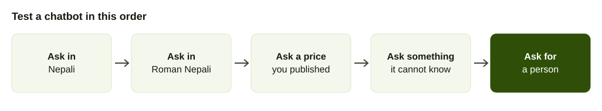
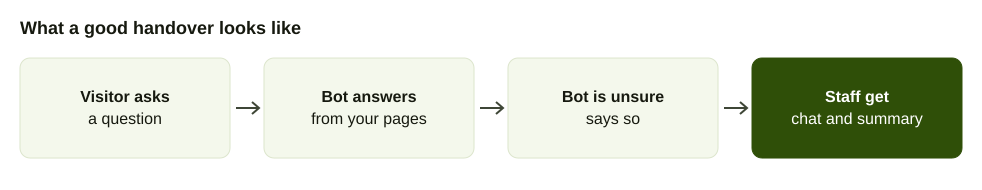

A chatbot is the small chat box in the corner of a website. For a business in Kathmandu, the useful question is not which one is "best". It is which one understands your customers, answers only what you have told it and gets out of the way when it cannot help.

For the definition, see the [chatbot glossary entry](/glossary/chatbot). This guide is for buying. It lists the prices each vendor publishes, explains why they are hard to compare and gives a test you can run in Nepali.

## What a Nepali business needs from a chatbot

1. **It understands how your customers write.** People type Nepali in Devanagari, in Roman letters and in a mix with English. A bot that handles only one will fail on many real messages.
2. **It answers from your information.** Prices, hours, delivery areas and policies come from your own pages, not from a general guess.
3. **It admits when it does not know.** The right reply to something it cannot answer is "let me get a person", not a confident error.
4. **It hands over properly.** Staff receive the chat so the customer does not repeat themselves.

## Published prices, side by side

Every figure below was on the vendor's own pricing page when we opened it in October 2026. Where a page offers monthly and annual billing, the price shown is the one on the page. The last column is our own division of price by allowance, to put plans on one footing. It is not a vendor figure.

| Provider | Plan / service | What's included | Price | Cost per unit (our division) | Source | Checked |
| --- | --- | --- | --- | --- | --- | --- |
| Edesy | Free | 100 messages a month, website embed, 5 languages | $0 | n/a | [Edesy](https://edesy.in/ai-chatbot/countries/nepal) | Oct 2026 |
| Edesy | Pro | 5,000 messages a month, 50+ languages, analytics | $29 a month (shown as Rs 2,400) | about $0.006 per message | [Edesy](https://edesy.in/ai-chatbot/countries/nepal) | Oct 2026 |
| Edesy | Business | 25,000 messages a month, 100+ languages, API access | $96 a month (shown as Rs 8,000) | about $0.004 per message | [Edesy](https://edesy.in/ai-chatbot/countries/nepal) | Oct 2026 |
| Chatbase | Hobby | 700 message credits a month, 2 members | $32 a month billed yearly | about $0.046 per credit | [Chatbase](https://www.chatbase.co/pricing) | Oct 2026 |
| Chatbase | Standard | 4,000 message credits a month | $120 a month billed yearly | $0.03 per credit | [Chatbase](https://www.chatbase.co/pricing) | Oct 2026 |
| Chatbase | Pro | 15,000 message credits a month, 5 members, advanced analytics | $400 a month billed yearly | about $0.027 per credit | [Chatbase](https://www.chatbase.co/pricing) | Oct 2026 |
| Botpress | Free | 100 conversations, 3 seats, no top-ups | $0 | n/a | [Botpress](https://botpress.com/pricing) | Oct 2026 |
| Botpress | Plus | 250 conversations a month, extra packs of 100 for $65 | $150 a month billed annually | $0.60 per conversation | [Botpress](https://botpress.com/pricing) | Oct 2026 |
| Botpress | Team | 1,500 conversations a month, extra packs of 100 for $50 | $750 a month billed annually | $0.50 per conversation | [Botpress](https://botpress.com/pricing) | Oct 2026 |
| Tidio | Starter | 100 billable conversations, 50 Lyro AI conversations one-off | $24.17 a month on annual billing | about $0.24 per billable conversation | [Tidio](https://www.tidio.com/pricing/) | Oct 2026 |
| Tidio | Growth | From 250 billable conversations | From $49.17 a month on annual billing | about $0.20 per conversation | [Tidio](https://www.tidio.com/pricing/) | Oct 2026 |
| Tidio | Plus | AI and human conversations billed separately | From $300 a month plus usage | Not stated | [Tidio](https://www.tidio.com/pricing/) | Oct 2026 |
| Intercom | Fin AI Agent | Pay per resolved outcome, on top of Essential seats | $0.99 per outcome, plus $19 per seat a month on the page's default view | $0.99 per outcome | [Intercom](https://www.intercom.com/pricing) | Oct 2026 |
| AakashTel | Smart AI Chatbot | Nepali company, listed beside its IVR and bulk SMS | Not published | n/a | [Ratopati](https://english.ratopati.com/story/54770/aakash-tels-ai-powered-ivr-system-making-customer-call-service-more-effective) | Oct 2026 |
| AirFone | Website chatbot and voice agent | Answers in Nepali or English from your own information | See the pricing page | n/a | [AirFone pricing](/pricing) | Oct 2026 |

Botpress adds that every conversation includes $0.10 of AI usage covered by the vendor on Plus, as the page states. Tidio's Plus plan, per the same page, bills AI and human conversations separately at lower rates as you scale.

## Why the numbers are hard to compare

The units differ.

- **Per message** (Edesy). One reply from the bot. A chat of ten exchanges is ten messages.
- **Per message credit** (Chatbase). Credits are spent as the bot answers, and the cost per answer depends on the model used. The page shows add-on credits at $40 per 1,000.
- **Per conversation** (Botpress, Tidio). One whole chat, however long.
- **Per resolved outcome** (Intercom Fin). You pay $0.99 only when the bot resolves the chat, plus seats for your staff.

A worked comparison with our own division of the prices above. A shop receives 300 chats a month, each ten messages long.

| Plan | Unit counted | Units used | Fits the plan? |
| --- | --- | --- | --- |
| Edesy Pro | 5,000 messages | 3,000 messages | Yes, with room |
| Chatbase Standard | 4,000 credits | Depends on credits per answer, which the page does not fix | Check with the vendor |
| Botpress Plus | 250 conversations | 300 conversations | No, 50 over, so one extra pack of 100 at $65 |
| Tidio Growth | From 250 billable conversations | 300 billable conversations if staff handle them | Check the step above 250 |

A clinic with 2,000 chats a month lands in different places again. The point is not that one is cheapest. It is that the same traffic produces different bills, so ask each vendor to price your last month of chats.

## Does it speak Nepali?

This is where published evidence is thin. Edesy's Nepal page states Nepali as its primary language, but it gives no test data, and its accuracy figures are the vendor's own ([Edesy](https://edesy.in/ai-chatbot/countries/nepal)). The pricing pages for Tidio, Chatbase, Botpress and Intercom that we opened do not list Nepali. We could not confirm Nepali on those products from the vendors' own pages, so treat support as unproven until you test it.

## How to test a chatbot in Nepali

Run the same test on every candidate, using a free plan or demo and your own questions.

1. **Ask ten real questions** from your last month of calls and messages, typos included.
2. **Ask each in Devanagari, then in Roman Nepali.** The answers should agree. Examples: "तपाईंहरूको खुल्ने समय कति बजे हो?" and "tapai haru ko opening time kati baje ho?"
3. **Ask a price or policy you have published.** Check the number matches your site exactly.
4. **Ask something it cannot know.** "Is my order 4521 shipped?" It should say it cannot see that and offer a person.
5. **Ask for a human.** Count the messages it takes. One is the right number.

Score each answer as right, wrong or confident and wrong. The third group is the dangerous one. A bot that is wrong and says so is better than one that is wrong and sounds sure.

## What a good handover looks like

When the bot is unsure it should say so, collect the visitor's name and number and pass the whole chat to staff. Ask each vendor to show you what staff receive. With AirFone, a handover from the AI call agent reaches staff with a summary, and staff answer from the app or a browser.

## Chat, voice or both

Some visitors will not type. They are on a phone, or more comfortable speaking Nepali than writing it. A voice agent on the same page answers them by speaking. [Adding a voice agent to your website](/blog/website-voice-agent) explains what visitors ask it. AirFone offers both a website chatbot and a voice agent, and an AI call agent on the phone line. The phone side is covered in [AI call agents for Nepali businesses](/blog/ai-call-agent-guide).

## What to put in it first

The quality of the answers depends on what you give it. Start with the ten questions your team answers most. Write each answer as you would say it to a customer, with the real price, hours and policy. Add delivery areas and payment methods. Add what you do not do, so the bot says no politely instead of guessing. Then read the first hundred chats, mark every wrong answer, fix the source and ask again.

## Who should own it

Give the chatbot an owner who reads the chats, fixes answers and decides when a question deserves a page on your site. Set a weekly ten-minute slot to read the chats that ended in a handover. Each is either a gap in your information or a question that needs a person.

## Questions to ask before you buy

- What exactly counts as one billable unit, and what happens when I go over?
- Can you price my last month of chats?
- Which information can I give it, and how do I change an answer?
- Where do chats go when the bot gives up?
- Can I see every conversation, including the ones it got wrong?
- Where are my customers' messages stored?
- Can I cancel without losing my content?

## Common mistakes

- **Buying on the demo.** Demos use questions the bot was built for.
- **Trusting a language list.** Supporting a language and answering well in it are different.
- **Hiding the human option.** Customers who cannot reach a person leave.
- **Never reading the chats.** The wrong answers are your fix list.
- **Using one tool for everything.** A chatbot suits repeat questions. Calls with upset customers need people.

## A simple way to decide

If most of your questions come by phone, start with the phone line. If most come to your website and you get a few hundred a month, a free plan is enough to learn from. If you run both, pick one vendor that handles chat, voice and calls from the same business information, so a price change is made once.
