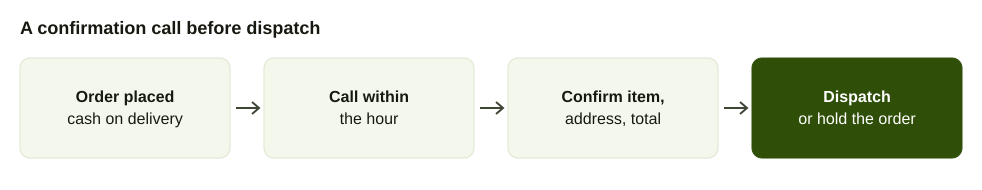
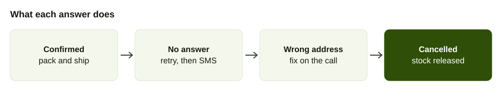

Every online seller in Nepal who offers cash on delivery knows the parcel that comes back. The rider spent a morning on it. The buyer was out, or gave a wrong lane, or said "I never ordered this". The goods return, the fee is paid and the stock is out of circulation for a week.

This guide is about stopping that before dispatch with a short phone call. It is for sellers on their own site, social pages and marketplaces who confirm orders by hand today, or do not confirm them at all.

## What failed cash on delivery orders cost

Count it for one order: the delivery fee out, the delivery fee back, the packaging, the rider's time and the item that cannot be sold while it travels. If the item is perishable or seasonal, it may not be sellable at all afterwards.

We looked for a published refusal rate for Nepal in October 2026 and did not find one. Figures that circulate from India are not a reliable guide for Nepali shoppers. So measure your own: of the last 100 cash on delivery orders, how many were refused or returned? That number tells you how much a confirmation call can save.

## What the call checks

A confirmation call is not a sales call. It checks four things.

1. **The buyer exists.** Someone answers at the number on the order.
2. **They remember ordering.** It filters out mistaken taps and mischief orders.
3. **The address works.** Landmarks, the ward, the floor and a phone number the rider can use.
4. **The total is understood.** The item, the price and that they will pay cash on arrival.

A buyer who has confirmed those four is far more likely to open the door.

## Which orders to call first

If you cannot call everyone, sort by risk.

- **First-time buyers.** No history with you.
- **High-value orders.** The ones that hurt most if they fail.
- **Incomplete addresses.** "Near the temple, Kathmandu."
- **Orders placed late at night.** Often impulse or mischief.
- **Repeat refusers.** Anyone whose number has refused before.
- **Large quantities** of one item.

A returning buyer with two good deliveries behind them may only need an SMS.

## What to say (example script)

Keep it under a minute. Name the shop and the item, read back the address and ask for a yes.

> Example: a clothing shop selling a Rs 2,400 kurta. "Namaste, this is [shop name]. You ordered a blue kurta, size M, for Rs 2,400 cash on delivery to [area], near [landmark]. Is that right? Press 1 to confirm. Press 2 if something needs to change."

If a person calls, the same structure applies: who you are, what they ordered, where it goes, how much to pay and one question.

If the buyer says "I did not order this", thank them and cancel. That is a good outcome. You saved a delivery.

## Manual, automated or mixed

You have three ways to run it.

| Approach | Works when | Watch out for |
| --- | --- | --- |
| Staff call each buyer | Under 30 orders a day | Calls fall behind at peak times and when staff are off |
| Automated confirmation call | Many orders and simple confirmations | Buyers who want to change something need a person |
| Mixed | Most shops | Needs clear rules for what goes to staff |

A phone system with bulk calling can ask each buyer a question and save the answers. AirFone's smart bulk calls collect answers into forms, and staff answer calls from the app or a browser. Supervisors can listen to a live call, guide, take over or transfer. See [pricing](/pricing) for what it costs, and [bulk voice calls in Nepal](/blog/bulk-voice-call-nepal) for how to run a list.

## The workflow

1. **Order arrives.** It sits as "to confirm", not "ready to pack".
2. **Call within an hour or two.** The sooner you call, the better the buyer remembers.
3. **Confirm the four points.** Buyer, order, address, total.
4. **Update the status.** Confirmed, changed, cancelled or unreachable.
5. **Dispatch only confirmed orders.** Hold unreachable ones until they answer.
6. **Review weekly.** Compare refusals for confirmed and unconfirmed orders.

## When nobody answers

A missed confirmation is not a cancellation. Retry the call twice at different times, for example late morning and early evening. Then send an SMS saying the order is on hold and asking the buyer to call back. [Bulk SMS in Nepal](/blog/bulk-sms-nepal) covers sender IDs and rules for that message.

Put a time limit on it. If there is no answer after a day, cancel and release the stock. A parcel that nobody confirmed is the one most likely to come back.

## Calls back from buyers

Buyers will call the number that called them. Make sure it is answered. Use a queue so callers wait instead of hearing a busy tone, and set voicemail for after hours. An AI call agent can answer "where is my order" and "can I change my address" in Nepali or English from your own information, and hand over to staff with a summary when it cannot. The [call center guide](/blog/call-center-software-nepal) explains how the queue works.

## Keep the record in one place

Write each outcome against the order. A simple sheet with columns for order number, phone, status, time called and who called prevents the same buyer being called three times by three people. With smart bulk calls the answers are collected into a form.

## Measure the effect

Compare two numbers over a month: refusals among orders you confirmed by phone and refusals among those you did not. If confirmed orders fail far less, the call is paying for itself. If not, look at your address checks, your product photos and your delivery estimates, because the fault may be in the order and not the buyer.

## What cash on delivery costs a Nepali store

WebsNP, a Kathmandu web developer, lists four costs of cash on delivery in an August 2026 article: failed deliveries (refused at the door, buyer not home, changed their mind or never meant to buy), cash handling by every rider, delayed cash flow that can lag by a week or more in busy weeks, and cash that goes missing ([WebsNP](https://www.websnp.com/help/cod-vs-online-payment-nepal-ecommerce-cost)). It recommends offering both payment paths and nudging towards prepaid with small discounts or faster delivery, since first-time cash buyers often switch once they trust you.

It also gives a rule of thumb for your own refusal rate: under 5 percent is manageable overhead, and above 15 percent means cash on delivery is costing more than the trust it buys, at which point it suggests tightening confirmation before dispatch with a quick call or SMS. Those thresholds are WebsNP's judgement, not a measured Nepal average, but they give you a line to compare yourself against.

| Your refusal rate (WebsNP's rule of thumb) | What it suggests |
| --- | --- |
| Under 5 percent | Manageable overhead. Keep monitoring. |
| 5 to 15 percent | Between the two thresholds. Confirm the riskiest orders first. |
| Above 15 percent | Confirm before dispatch and review who you offer cash on delivery to. |

## A risk ladder instead of confirming everything

Shipmozo, an Indian logistics blog, recommends a three or four level ladder rather than labelling orders safe or fraudulent: normal orders go straight to fulfilment, review orders get a confirmation, and restricted orders need another payment method or manual approval. Its signals are unusual quantity, phone validity, address completeness and previous return behaviour, and it advises using several signals together, not one ([Shipmozo](https://www.shipmozo.com/blog/reduce-cod-return-fraud-beyond-address-verification)). It also says confirmation should cover the product, the amount and the delivery location, offer a simple way to cancel, and record the answer and the time.

| Level | Example signal | Action |
| --- | --- | --- |
| Normal | Repeat buyer, complete address | Ship, send an SMS with the delivery details |
| Review | First order, or address missing a landmark | Confirmation call before packing |
| Restricted | Several signals together, or earlier refusals | Ask for prepayment or hold for a manager |

## Message templates

**Confirmation call, 25 seconds.**

> "Namaste, this is [shop name]. You ordered [item] for Rs [total], cash on delivery, to [area and landmark]. Is that right? Press 1 to confirm, 2 to change something, 3 to cancel."

**SMS for a returning buyer.**

> "[Shop name]: your order [number], Rs [total] cash on delivery, will be delivered tomorrow to [area]. Reply or call [number] to change."

**SMS after no answer.**

> "[Shop name]: we could not reach you about order [number]. It is on hold. Please call [number] to confirm."

## Using the buyer's number only for the order

Nepal's Individual Privacy Act 2075 counts a telephone number as personal information and restricts using information collected for one purpose for another, according to [Pioneer Law's summary of the Individual Privacy Act 2075](https://pioneerlaw.com/individual-privacy-act-2018-2075). A buyer who gave you a number to deliver an order has agreed to calls about that order. Calling the same number later with unrelated offers is a different purpose.

## What the evidence says

We looked for Nepali data on refused cash on delivery orders and found none published, so this post makes no claim about how common refusals are. Count your own: refused or returned orders divided by all cash on delivery orders over the last month. A confirmation call gives you what the courier cannot, an answer from the buyer before the parcel leaves.

## Common mistakes

- **Calling too late.** After three days, buyers forget.
- **Sounding like a collection call.** Be brief and friendly.
- **Asking for a prepayment on the call.** That is a different policy. Decide it separately.
- **Ignoring changes.** If the buyer wants another size, fix the order then and there.
- **Not telling the rider.** Pass on the corrected address and the buyer's second number.

## What to say when the buyer sounds unsure

Some buyers will say "maybe". Do not push. Offer to hold the order for a day, say what the price and delivery fee are, and let them call back. A buyer who is pressed into a yes is the one who refuses at the door. A held order costs you nothing but shelf space.
