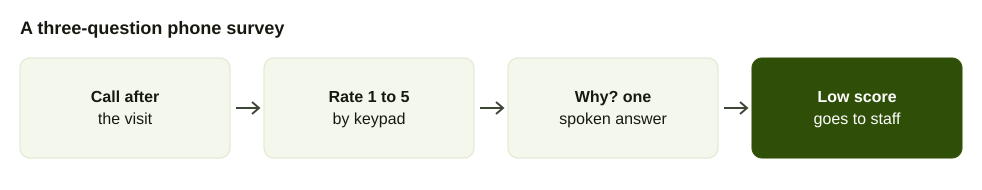
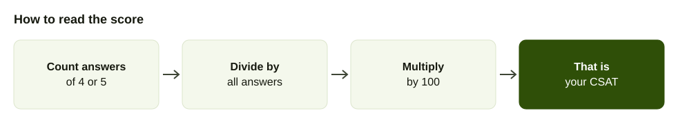

A customer leaves your clinic, shop or restaurant and you ask, "How was it?" The honest answer is usually "fine". A rating given a day later to a stranger on the phone is a bit different. It is quick, it is private and it tells you something you did not hear at the counter.

This guide explains how to run a phone survey that customers will answer: what to ask, when to call, how to work out the score and what to do with the results. If you want to send the calls to a whole list at once, [bulk voice calls in Nepal](/blog/bulk-voice-call-nepal) explains the mechanics.

## Why survey by phone

Link surveys depend on the customer opening a message, tapping a link and typing. Many Nepali customers will not. A call asks the same question in a language they speak, and costs them ten seconds.

Phone has other advantages.

- **It reaches everyone with a number.** Not only people who check email.
- **It allows one open question.** "Why did you give that score?" gets a real sentence.
- **It can go straight to a person.** A very unhappy customer can be put through to staff.

It also has limits. A call interrupts, so keep it short, call at sensible hours and let people say no.

## What to ask

Two or three questions is the right number. A fourth costs you completed surveys.

1. **The rating.** "On a scale of 1 to 5, where 5 is very satisfied, how was your visit today?" Answered by a key press or a spoken number.
2. **The reason.** "In a few words, what is the main reason for that score?" Spoken, optional.
3. **The follow-up.** "Would you like someone from us to call you back? Press 1 for yes." Only if the score is low.

Ask about the thing you can change. "How was the waiting time?" tells you more than "How was your experience?" if waiting is what you are fixing.

Avoid questions that suggest an answer ("How great was our service?"), two questions in one ("How were the food and the staff?") and anything personal.

## When to call

Call soon after the event, while the customer still remembers it.

- **After a visit:** the same evening or the next morning.
- **After a delivery:** the day after it arrives.
- **After a support call:** within a few hours.
- **After a hospital or clinic visit:** the next day, and never during meals or late at night.

Use daytime hours. Call each customer once. If they do not answer, try one more time on a different day and then leave it.

## Example script

Name yourself, say it takes under a minute and ask the first question.

> Example: a dental clinic. "Namaste, this is [clinic name]. You visited us yesterday. May we ask two quick questions? On a scale of 1 to 5, where 5 is very good, how was your visit? Press the number on your phone."

Then, for the reason: "Thank you. In a few words, what is the main reason for that score?"

Close with thanks. If the customer sounds irritated at the start, apologise and end the call. Write that number down so you do not call again.

## How to calculate CSAT

CSAT is the share of satisfied answers. On a five-point scale, count the 4s and 5s, divide by the number of people who answered and multiply by 100. Parloa calls this the top-two-box percentage ([Parloa](https://www.parloa.com/knowledge-hub/csat-survey-questions/)). Some teams report an average rating instead. Pick one and keep to it.

Example calculation: 80 people answered. 52 gave a 5, 12 gave a 4, 9 gave a 3, 4 gave a 2 and 3 gave a 1. The satisfied answers are 52 plus 12, which is 64. 64 divided by 80 is 0.8, so CSAT is 80 percent.

### Response rate is separate

The response rate is how many answered out of how many you tried to reach. People who did not answer belong in the response rate, not in the score. Clootrack separates three measures that are often confused: response rate (completed out of those invited), completion rate (finished out of those who started) and participation rate (started out of those invited) ([Clootrack](https://www.clootrack.com/cx-guide/survey-response-rate-guide-cx-insights)). On a phone survey, track all three: how many you reached, how many started rating and how many finished the reason. A low completion rate points to the script, not the customers. We found no trustworthy phone benchmark, so compare your own surveys with each other.

## What to do with low scores

A score is only useful if it leads to something. Decide before you start.

1. **1 or 2: call back the same day.** A person calls, listens and fixes it if they can. With AirFone, answers are collected into a form that staff can read.
2. **3: read the reason.** Neutral answers tell you what to improve.
3. **4 or 5: thank them.** And read the reasons for patterns.
4. **Every week: read all the reasons.** Group them into five or six themes.
5. **Every month: fix one thing** from the top theme, and tell the customers who raised it.

The follow-up call is the real value of the survey. A number on a chart does not repair a bad visit.

## Running it by hand or automatically

A person can work through a short list by hand. For a longer list, automation helps. AirFone's smart bulk calls ask your questions and collect the answers into forms. Calls are transcribed, and a supervisor can listen to a live call, guide, take over or transfer. See [pricing](/pricing).

Whoever makes the calls, do not use the survey to sell. A satisfaction call that turns into an offer teaches customers not to answer.

## Why phone surveys get ignored

Phone surveys face a trust problem before the first question. Pew Research found that typical response rates to its US telephone polls fell to 7 percent in 2017 and 6 percent in 2018, after holding near 9 percent for several years. It points to automated telemarketing, an estimated 3.4 billion robocalls a month in the US, because a survey call from an unknown number is easily mistaken for a sales call, and phones sometimes flag survey calls as spam ([Pew Research Center](https://www.pewresearch.org/short-reads/2019/02/27/response-rates-in-telephone-surveys-have-resumed-their-decline/), February 2019). That is American polling, not Nepali customer surveys, but it explains why the first sentence of your call matters.

What follows for a business calling its own customers:

- **Say who you are in the first sentence,** with the business name the customer knows.
- **Mention the visit or order,** so the call is recognised as theirs.
- **Say how long it takes.** "Two quick questions" tells the person it is not a sales call.
- **Call from a number they can call back,** and make sure someone answers it.

## How established phone systems run the same survey

Large contact-centre products already ship this feature, and their design choices are a useful template. Google's contact centre platform asks the caller for a fixed 1 to 5 rating on the keypad after an inbound call, stores the result against the call and lets the administrator announce the survey either before the caller reaches an agent or only at the end. A caller gets three tries to enter a valid key, and if all three fail the call ends with no score recorded. The feature can be switched on globally or per queue ([Google Cloud CCAI documentation](https://docs.cloud.google.com/contact-center/ccai-platform/docs/csat-calls)).

Three lessons carry over to a Nepali business with no special software.

1. **Use one fixed scale.** 1 to 5, always, so months stay comparable.
2. **Allow a retry, then stop.** Three tries is a reasonable limit. Do not trap a caller.
3. **Decide per team.** A survey after the front-desk team's calls and not after a billing dispute is a choice you make deliberately.

## The bias in a post-call score

Parloa warns that a CSAT number from a self-selected sample can mislead, because the respondents are whoever chose to answer, and that surveying every caller tires frequent callers ([Parloa](https://www.parloa.com/knowledge-hub/csat-survey-questions/)). It gives the arithmetic plainly: if 800 of 1,000 respondents rated a queue 4 or 5, the CSAT for that queue is 80 percent.

For a small business the practical consequences are these.

- Report the number of answers beside the score. "80 percent of 30 answers" is weaker than "80 percent of 400".
- Do not compare a score taken at the end of a call with one taken a day later. They sample different people.
- Do not survey the same customer every week.
- Read the spoken reasons. They carry the information the score hides.

## Question templates

Keep the same rating wording every time so trends are comparable.

**After a clinic visit (example).** "On a scale of 1 to 5, where 5 is very good, how was your visit yesterday? In a few words, what is the main reason?"

**After a delivery (example).** "Your order arrived yesterday. On a scale of 1 to 5, how happy are you with it? If it is 1 or 2, press 1 and we will call you back."

**After a support call (example).** "On a scale of 1 to 5, how well did we solve your problem today?"

**For a restaurant (example).** "How was your meal? Press 1 to 5. What should we change? You can say it after the tone."

Branch on the score: send low scores to a follow-up question or a person, and thank high scores. Design the branch on paper before you build it.

## Pairing it with missed-call tracking

A survey measures people who reached you. It does not measure those who could not. Combine it with [measuring missed calls](/blog/measure-missed-calls-business) to see both the experience of customers you served and the number you never reached.

## Respect the customer

- Call only people who dealt with you.
- Say who you are and how long it takes.
- Accept "no" at once.
- Keep answers to the team that needs them, and do not pass numbers to anyone else.
- If a customer asks not to be called again, write it down and honour it.

## Common mistakes

- **Too many questions.** Cut to the one rating and one reason.
- **Surveying too late.** After a week, the visit is a blur.
- **Reporting the average of a tiny sample.** Ten answers is a conversation, not a statistic.
- **Not acting on it.** If nothing changes, stop calling. It costs you goodwill.
- **Mixing the survey with selling.** Keep them separate.

## A first survey in one week

On Monday, write the two questions and the script. On Tuesday, test it with five staff or friendly customers and fix anything that sounds odd. On Wednesday, call 30 customers from the last two days. On Thursday, read every answer and call back anyone who scored 1 or 2. On Friday, work out the CSAT and write down the top two reasons.

You now have a baseline. Run the same survey a month later and compare. The score matters less than the reasons, because the reasons tell you what to change.
