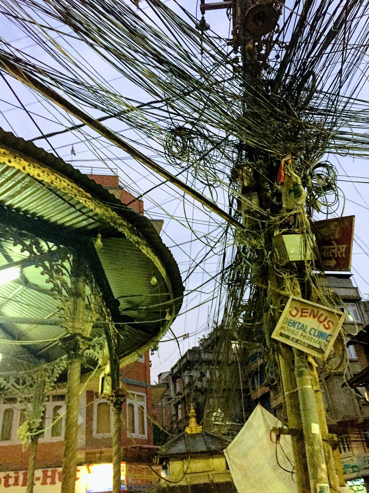

Most offices in Kathmandu that have been around for a while have one. A grey box in a cupboard or on a shelf above the router, with a tangle of cables coming out of the back and a small green light that blinks. Next to it, on a strip of masking tape, the number of the technician who installed it.

Nobody thinks about the box until it needs to do something new. Then everyone thinks about it at once.

This guide is only about that box: when it is fine to keep, when it starts costing you, and what really changes if you replace it. If your question is about which number to use, read [your business phone number in Nepal](/blog/business-phone-number-nepal). If it is about running a team that handles a lot of calls, read [call center software for small businesses](/blog/call-center-software-nepal).

## What the box actually does

A PBX is the part of your phone setup that turns one or two lines into an office. It gives each desk an extension, lets the receptionist transfer a call to accounts, plays the "press one for sales" menu, and decides which phone rings when someone dials in.

A traditional PBX does all of that in hardware. The rules live inside the box, and the box is wired to particular desk phones in particular rooms. That is its strength, because it is simple and it works, and also its weakness, because everything about your phones is now tied to that cupboard.

## When keeping it is perfectly reasonable

If you have one office, everyone answers from a desk phone, the menu has not changed in years and calls are rarely missed, there is no urgent reason to change. A working box that nobody needs to touch is not a problem.

It is worth being honest about that, because replacing a phone system for its own sake is a distraction. The question is whether your business still looks like the one the box was installed for.

## The signs it is holding you back

It usually shows up in small, annoying ways before anyone calls it a phone problem.

The receptionist goes on leave and the main line only rings at her desk, so for a week nobody answers it properly. A manager starts working from home on Fridays and cannot take calls. You open a second branch in Lalitpur and it ends up with a separate number, a separate box and no way to transfer a customer between the two.

Every change to the menu or opening hours needs the technician, who can come next Tuesday. During festivals, when the office closes early, the phones keep ringing to an empty room because nobody remembered to change the hours.

And when a customer says "but your staff told me last month", there is no recording to check.

None of these is a disaster by itself. Together they mean the box is now deciding how your business can work, rather than the other way round.

## What changes when it moves online

An IP PBX, often called a [cloud PBX](/products/phone-system), does the same job without the hardware. The rules that lived in the box now live online, and you change them yourself.

Your existing number connects to it over a SIP line, so customers dial exactly what they always have. Each person gets an extension they can answer in the AirFone app on their phone or in a browser on their laptop, so calls follow people instead of desks. A branch in Lalitpur sits on the same system as head office, and a call can be passed between them like any other transfer.

Opening hours, menus and queues become settings you edit in a few minutes, including that early closing time during Dashain. Every call is recorded, so the "your staff told me" conversation takes two minutes instead of an argument.

And because calls now run through software, you can add an [AI call agent](/products/ai-call-agent) later to answer when nobody is free, without installing anything else.

## What the switch looks like

For most offices the change is quieter than people expect.

The number is connected to the online system, everyone installs the app or opens the browser version, and the menu and opening hours are set up to match how the old box behaved. Then calls start arriving the new way. Customers hear the same number and, if you want, the same greeting.

The old box can stay switched off in the cupboard for a few weeks while everyone gets comfortable, and then it can go.

## What the lines and links cost

The box is only part of the bill. A Nepal Telecom landline costs Rs 1,635 to install and Rs 200 a month, which includes 175 free calls, then Rs 1 a minute for local calls to other Nepal Telecom numbers ([NepaliTelecom guide](https://www.nepalitelecom.com/nepal-telecom-ntc-landline-phone), updated June 2026, checked October 2026). Mobile calls are billed by the minute too: one tariff guide lists Rs 1 a minute at peak hours between Nepal Telecom numbers and Rs 1.5 to Ncell, before tax ([NepaliTelecom tariff guide](https://www.nepalitelecom.com/voice-call-rates-in-ncell-ntc-smart-cell), last updated July 2024, checked October 2026). An online phone system also needs a steady internet link. Nepal Telecom launched a 30 Mbps fiber package at Rs 4,999 a year on 16 October 2026 ([ShareSansar](https://www.sharesansar.com/newsdetail/nepal-telecom-unveils-30-mbps-fiber-internet-at-rs-4999-a-year-2026-10-16), checked October 2026). Put these next to what you pay now, plus the technician's visits, before deciding. For what AirFone charges, see [pricing](/pricing).

## The short version

Keep the box if your business still fits it. Replace it when it starts deciding who can answer, where they can be and how quickly you can change anything. The number stays, the cupboard gets a little emptier, and your phones start working the way your business already does.
