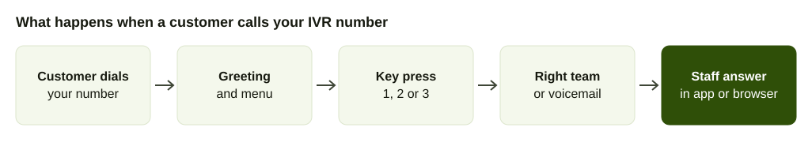
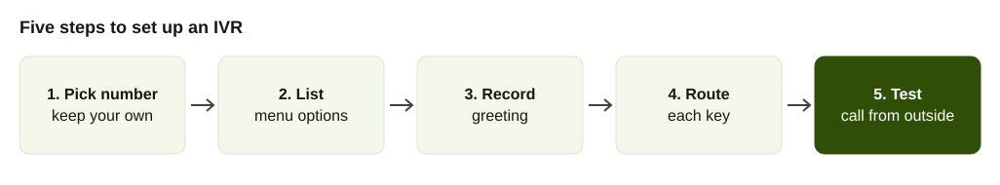

You called a bank or a hospital, heard "press 1 for," and reached the right desk without speaking to anyone. That is an IVR, and it is no longer something only large companies can run.

This guide covers the practical side for a Nepali business: who offers IVR, which prices are published, how toll-free numbers work and how to build a menu. It does not argue whether an IVR is the right tool. For that, read [IVR versus an AI call agent](/blog/ivr-vs-ai-call-agent), and for the definition see the [IVR glossary entry](/glossary/ivr).

## Where IVR is used in Nepal

NepaliTelecom's explainer says IVR in Nepal is mostly used by the telecom operators, and anyone who has called NTC or Ncell and heard automatic voices has used one ([NepaliTelecom, February 2025](https://www.nepalitelecom.com/ivr-in-nepal)). Banks followed. NIC Asia Bank was reported as the first to bring IVR banking to Nepal ([Share Sansar](https://www.sharesansar.com/newsdetail/24-7-banking-service-just-a-call-away-now-nic-asia-bank-brings-ivr-banking-service-for-the-first-time-in-nepal)). Its help page, last modified in December 2019, says callers paid standard Nepal Telecom call charges to reach the IVR and that the bank was working on toll-free access ([NIC Asia help desk](https://helpdesk.nicasiabank.com/support/solutions/articles/35000146103-7-is-nic-asia-ivr-services-free-of-cost-)).

AakashTel reports that IVR use is rising in banks and financial institutions, hospitals, education, helplines, corporate offices and e-commerce ([Ratopati, March 2026](https://english.ratopati.com/story/54770/aakash-tels-ai-powered-ivr-system-making-customer-call-service-more-effective)). For a small business the question is how to get the same thing without building it.

## Three types of IVR

NepaliTelecom describes three set-ups that providers use ([NepaliTelecom](https://www.nepalitelecom.com/ivr-in-nepal)).

| Type | How the caller responds | Example from the source | Fits |
| --- | --- | --- | --- |
| Touch-tone replacement | Presses keys on the keypad | "Press one for Nepali" | Menus with a few fixed options |
| Directed dialogue | Says a short phrase the system expects | "Are you calling to check your mobile balance?" answered with "Check mobile balance" | A single clear question |
| Natural language | Speaks freely | "Which specific service do you want?" answered with "I am trying to know my mobile balance" | Many possible requests |

For a small business, touch-tone is the practical start. It works on every phone and in a noisy shop, and it needs no speech recognition. Speech and natural-language menus ask the caller to talk, which is where an [AI call agent](/blog/ai-call-agent-guide) takes over from a menu.

The same page lists the weak points of IVR that you should design against: long waits before reaching an option, long voice messages and step-by-step selections, and recorded messages that cannot comprehend a complicated problem. It also notes that callers of a pay-per-minute IVR dislike long menus more, because they pay while they listen.

## What Nepali callers already know

Callers in Nepal have met IVR through their operators. NepaliTelecom lists NTC services reached by IVR call: SEE and Class 11 and 12 results at 1601, TU results at 1602, complaints and agent calls at 198 and landline bill queries at 1606. It says Ncell prepaid customers reach IVR services on 9005. Those menus set the habit your customers bring: press a number, hear a short answer, press a number to reach a person. A menu that follows that pattern needs no explanation.

## Who provides IVR in Nepal

There are four kinds of provider.

**Nepal Telecom, outbound.** NTC's Outbound IVR calls a list of numbers and plays a pre-recorded message of up to one minute, with 30 seconds preferred, supplied as a .WAV file with the number list in Excel. You apply with a form at the NTC office in Sundhara, Kathmandu, according to [NepaliTelecom's report](https://www.nepalitelecom.com/?p=109683). That report says recipients see the call as coming from the number registered to the sender. It is for broadcasting, not for answering your inbound calls, and the report does not give a price.

**Nepal Telecom, SIP PBX.** NTC sells a SIP PBX that gives an office multiple lines on one number. NepaliTelecom lists call queuing, voice messaging and conferencing among the features of IP PBX in general, and prices the NTC service in the table below ([NepaliTelecom](https://nepalitelecom.com/2018/12/ntc-sip-pbx-service-offices-multiple-phone-lines-single-number.html), last updated August 2022).

**Nepali messaging and voice companies.** AakashTel launched a multi-level IVR with AI text-to-speech voice, the option to record your own welcome message, smart routing, real-time call reports and voicemail to email. It also offers bulk SMS, voice broadcasting and a chatbot, per [Ratopati](https://english.ratopati.com/story/54770/aakash-tels-ai-powered-ivr-system-making-customer-call-service-more-effective). No price is published.

**Cloud phone systems.** An IVR is one feature of a cloud phone system, next to queues, voicemail and forwarding. AirFone is one: your existing number connects over a SIP line, you build the menu in the app and your team answers from the app or a browser. See the [phone system product page](/products/phone-system).

## What an IVR costs: every published price we found

We searched for inbound IVR price lists from Nepali providers in October 2026 and found none. Here is what is public.

| Provider | Plan / service | What's included | Price | Source | Checked |
| --- | --- | --- | --- | --- | --- |
| Nepal Telecom | SIP PBX, monthly charge | 15 sessions on one number | Rs 3,000 a month, excl. tax | [NepaliTelecom](https://nepalitelecom.com/2018/12/ntc-sip-pbx-service-offices-multiple-phone-lines-single-number.html) | Oct 2026 |
| Nepal Telecom | SIP PBX, one-off | Registration Rs 500, installation Rs 6,000 (includes 100 m fibre, then Rs 60 per metre), government ownership charge Rs 1,000 | Rs 7,500, excl. tax | same | Oct 2026 |
| Nepal Telecom | SIP PBX deposit | Local calls only, or with ISD | Rs 50,000 or Rs 150,000 | same | Oct 2026 |
| Nepal Telecom | SIP PBX calls | Landline rates | Same as landline | same | Oct 2026 |
| Nepal Telecom | Outbound IVR | Messages up to 1 minute to a number list | Not published | [NepaliTelecom](https://www.nepalitelecom.com/?p=109683) | Oct 2026 |
| AakashTel | AI IVR | Multi-level menu, own greeting, routing | Not published | [Ratopati](https://english.ratopati.com/story/54770/aakash-tels-ai-powered-ivr-system-making-customer-call-service-more-effective) | Oct 2026 |
| CloudTalk (international) | Per-user plan | Its page lists $25 per user a month, an industry average of $45 and a highest price of $175 | $25 per user a month | [CloudTalk](https://www.cloudtalk.io/ivr-phone-system-price/) | Oct 2026 |
| Twilio (international) | SIP trunk to Nepal, calls out | Termination per minute | $0.2941, mobile $0.3044 | [Twilio](https://www.twilio.com/sip-trunking/pricing/np) | Oct 2026 |
| AirFone | IVR with the phone system | Queues, voicemail, AI call agent | See the pricing page | [AirFone pricing](/pricing) | Oct 2026 |

Read the NTC rows with care. The SIP PBX page states the prices exclude regular government taxes, and the article was last updated in August 2022, so confirm the figures with NTC at Tripureshwor before you plan around them. The CloudTalk "industry average" and "highest price" are CloudTalk's own claims about 30 competitors.

When you ask any provider for a quote, get these in writing: setup fee, monthly fee, cost per minute for calls into the menu, what happens when two callers arrive at once, who changes the menu later and whether that costs extra.

## How toll-free numbers work

A toll-free number reverses the billing. The caller pays nothing and the business that issued the service pays for each call it receives ([NepaliTelecom's explainer](https://www.nepalitelecom.com/toll-free-number)).

In March 2022 the NTA board amended its Short Code and Toll-Free Number Management Action Plan. According to [NepaliTelecom](https://www.nepalitelecom.com/2022/04/toll-free-calls-to-any-network-now-free-nta-rules.html):

- Domestic toll-free numbers now start with 1810, followed by an operator code and six digits for the organisation. Before, they began with 1660.
- International toll-free numbers start with 1800, and a foreign company serving Nepali customers can offer one.
- A toll-free number must be 11 digits.
- A toll-free number from one operator is free to call from any other network, through interconnection between the operators.

We found no published monthly fee or setup charge for a toll-free number. NTC says the form is on its website, so ask the operator for the fee and the document list.

Do you need one? Only if callers would hesitate over the cost, as with a helpline, a complaints line or a service for people on low balances. For most shops, clinics and offices the number customers already know is the better choice. Read [choosing a business phone number](/blog/business-phone-number-nepal) before you buy another.

## How to set up an IVR in five steps

1. **Decide which number answers.** Use the number customers already dial. With a SIP line it keeps working while the menu sits in front of it.
2. **List the reasons people call.** Look at the last month of calls. Group them. Most businesses find three or four groups cover nearly everything.
3. **Write the greeting.** Say who you are, then the options. Record it in Nepali, English or both, with the most common language first.
4. **Decide where each key goes.** Each option ends at a team, a person, a queue, voicemail or a recorded answer. Decide what happens when the caller presses nothing.
5. **Test from outside.** Call from a mobile that is not on your system. Press every key. Ask someone who has never heard the menu to try it.

## Example menus you can adapt

Write for the ear. Put the option first, then the key: "For prices, press 1." The caller then knows what to listen for before the number arrives.

**A clinic (example).**

> "Namaste, Himal Clinic. For appointments, press 1. For lab reports, press 2. For billing, press 3. To speak to the front desk, press 0."

Key 1 goes to a booking team, key 2 to a lab team, key 3 to accounts and 0 to a queue for the front desk, with voicemail after the maximum wait.

**A shop with delivery (example).**

> "Namaste, Pasal Online. To check an order, press 1. To place an order, press 2. For anything else, press 0."

**A school (example).**

> "Namaste, Shree Janata School. For admissions, press 1. For fees, press 2. For the principal's office, press 3."

**A restaurant at peak time (example).**

> "Namaste, Himal Kitchen. We are busy and will answer shortly. To leave an order, stay on the line."

In each case the greeting is under 15 seconds of speech, offers three or four keys and has a zero for a person.

## What to put behind the menu

The menu is only the front. What happens after the key press decides whether callers are happy.

With AirFone, each option can send the call to a team, to a queue, to voicemail or to an AI call agent that answers in Nepali or English from your business's own information and hands over to staff with a summary. A [queue](/glossary/call-queue) can pick the longest idle person or go round robin, hold callers for a maximum wait and then overflow to voicemail, another team or the AI agent. The [guide to cutting hold time](/blog/reduce-call-hold-time) explains how to set those limits.

Staff answer from the app or a browser, so the menu does not depend on anyone sitting at a desk. Supervisors can listen to a live call, guide the agent, take over or transfer. Calls are transcribed, so a dispute about what was said can be settled by reading the transcript.

## Test it properly

Run this before you announce the number.

1. Call from a mobile on NTC and from one on Ncell.
2. Press each key and confirm it reaches the right place.
3. Stay silent and see what happens after the timeout.
4. Press a wrong key and see whether the menu repeats.
5. Call when the office is closed and check the after-hours path.
6. Call while another test call is in progress and check the queue.
7. Ask three people who have never heard it to find the information they need, and watch for hesitation.

Write down every problem and fix it before launch.

## Mistakes that make callers hang up

- **Too many options.** Past four, people forget the first one. Split into two levels instead.
- **Long greetings.** Callers who have heard it before press a key during the speech. Let them.
- **No way to a person.** Offer one key that reaches a human during opening hours.
- **Silence on hold.** A caller in a queue should hear that they are waiting.
- **Keys that go nowhere.** Every key must end somewhere.
- **Not testing after changes.** Festival hours and new staff change the routing. Call it yourself after each change.

If many callers ignore the menu and ask for a person anyway, the menu is the problem, not the callers. [Press 1 for sales](/blog/ivr-vs-ai-call-agent) covers what to try next.

## Keeping the menu useful over time

Review it each month for the first quarter. Look at which key gets pressed most, how many callers press nothing and how many hang up inside the menu. A key nobody uses can go. A key everyone uses may deserve a team of its own. Update the greeting when hours change, when a branch opens or when a festival closes the office. If your provider needs a ticket and a wait for each change, that is a reason to look at other options.

## Checklist before you sign

- Your existing number stays, or the provider says clearly what happens to it.
- Prices are written down: setup, monthly, per minute, deposit and tax.
- You know whether you need a toll-free number, and what it costs.
- Menu changes are something you do yourself, in minutes.
- Calls reach people on their phones or laptops, not only at desks.
- Opening hours and holidays are settings, not a technician visit.
- You can read a transcript when a customer disputes what was said.
