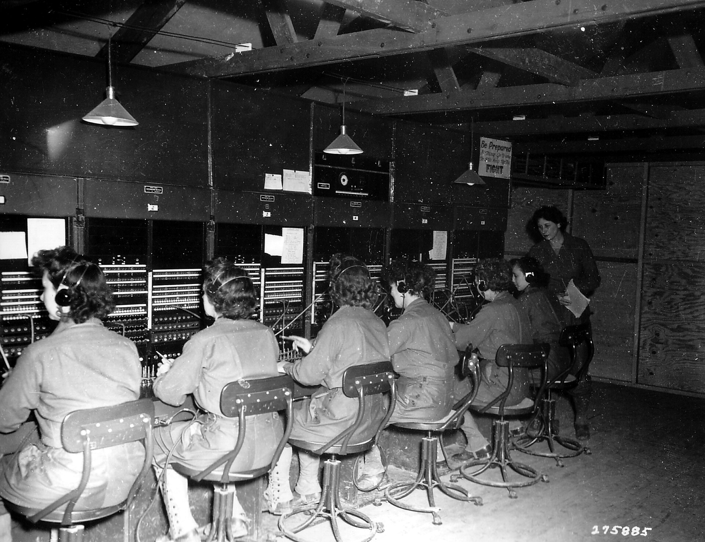

Every business that takes phone calls has a queue, even if nobody calls it that. When two people ring at once and one person answers, the second caller waits. When ten ring at once on a Sunday morning after a salary deposit, eight wait. Some of them hang up and try again. Some of them go to a competitor. You rarely find out which.

This guide explains why queues form, how to see yours clearly, and what actually shortens it.

## Why callers hang up

A caller on hold cannot see the line ahead of them. They do not know if they are second or twentieth. Silence or looping music makes a minute feel like five. On a mobile phone, many callers are also aware of the cost of the call.

Three things make waiting worse:

1. **No information.** The caller does not know how long the wait will be.
2. **No progress.** The same message repeats and nothing changes.
3. **No way out.** The only choices are to keep waiting or to give up.

Fix those three and callers wait longer and complain less, even before you shorten the actual wait.

## Measure the queue first

You cannot fix what you cannot see. Before changing anything, collect two or three weeks of call data and answer these questions:

- **How many calls arrive per hour, by day of week?** Most businesses find a few sharp peaks. Banks see them after salary days. Clinics see them when the phone lines open in the morning. Hotels see them in the evening.
- **How many callers hung up before being answered?** This is the abandon rate. Above ten percent means the queue is costing you customers.
- **How long did answered callers wait?** Look at the slowest ten percent, not the average. An average of forty seconds can hide many callers who waited four minutes.
- **How long does each call take?** Long calls in a busy hour make the queue grow fast.
- **What did callers want?** Listen to a sample, or read transcripts if you have them. Write down the reason for each call.

The last question is the most useful. In most businesses, a few reasons account for most calls. That is where the biggest savings are.

Our earlier guide on [measuring missed calls](/blog/measure-missed-calls-business) covers how to count calls that never reach anyone at all.

## Put people where the calls are

Once you know your busy hours, match staff to them. This sounds obvious, but many front desks are staffed evenly across the day while calls bunch up in two or three windows.

- Move breaks out of the peak hour.
- Ask staff who do other work, such as billing or bookings, to take calls during the peak only.
- If you have more than one branch, let calls overflow to a branch that is quiet.

A small change in who answers when often cuts the longest waits by half.

## Answer the simple questions automatically

A large share of calls are the same few questions. Opening hours. Where the branch is. Whether a booking is confirmed. The balance or status of something. These calls are short for staff, but in a busy hour they block the line for callers with real problems.

There are two ways to handle them without a person:

- **A menu**, where the caller presses a number. This works for a short list of fixed answers. It frustrates callers when the list grows long or their question is not on it. See [IVR or an AI call agent](/blog/ivr-vs-ai-call-agent) for the trade-offs.
- **An AI call agent** that understands the question in Nepali or English and answers it, or hands the call to staff with a summary when it cannot. Our [AI call agent guide](/blog/ai-call-agent-guide) explains how to set one up well.

Either way, the goal is the same: the person at the desk spends their time on calls only a person can handle.

## Tell callers where they stand

If a caller has to wait, tell them something true and useful:

- Their place in the queue, or a rough wait time.
- That they can hang up and be called back.
- Where else to get the answer, such as a website or a text message, if that is genuinely quicker.

Do not repeat "your call is important to us" every twenty seconds. It tells the caller nothing and it gets less believable each time.

## Offer a callback

A callback lets the caller hang up and keep their place. When an agent is free, the system calls them back. For the caller, it removes the worst part of waiting. For you, it smooths the peak: calls that would have piled up at 10 a.m. are handled at 10:20.

Callbacks only work if you keep the promise. If you say "within fifteen minutes", call within fifteen minutes. A callback that comes three hours later, or never, damages trust more than a long hold.

Two rules help:

1. Only offer a callback when you can see that staff will be free within the promised time.
2. Call back from the same number the business is known by, so the caller recognises it and picks up.

## Shorten the calls themselves

Hold time depends on how long each call takes. Small things add up:

- Give staff the caller's history on screen before they answer, so they do not ask for details the business already has.
- Write short answers for the ten most common questions and keep them where staff can see them.
- Send details by text message instead of reading them out, such as an account number, an address or a booking reference.
- Fix the reason for repeat calls. If many people call to ask whether a payment went through, send a confirmation message when it does.

The last point matters most. The cheapest call to handle is the one nobody needs to make.

## Do not let the queue grow forever

A queue with no limit means some callers wait ten or fifteen minutes. That is worse than telling them up front that the lines are busy. Set a limit:

- After a set wait, offer a callback or a message instead of more hold music.
- Outside working hours, say so at once, give the hours, and take a message.

## What more staff would cost

Adding people is the obvious fix and the most expensive one. Nepal's [minimum monthly wage rose to Rs 19,550](https://en.himalpress.com/?p=75907) in July 2025, and [entry-level receptionists earn about Rs 15,000 to 20,000 a month, and staff with one to three years of experience Rs 20,000 to 35,000](https://www.necojobs.com.np/blogs/career-tips/receptionist-jobs-in-nepal) (checked October 2026). Staff at that rate still handle one call at a time, so a second person helps at the peak but sits idle the rest of the day. Weigh that against the cheaper changes above. For what an AI call agent costs on AirFone, see [pricing](/pricing).

## Check the result every month

Once changes are in place, look at the same numbers each month: calls per hour, abandon rate, the slowest ten percent of waits, and the top reasons for calls. Share them with the people who answer the phone. They usually know the cause of a bad week before the numbers do.

## A short checklist

- Collect two weeks of call data before changing anything.
- Find the peak hours and staff them properly.
- List the top ten reasons people call.
- Answer the simple ones automatically, with an easy way to reach a person.
- Tell waiting callers how long, and offer a callback.
- Keep every callback promise.
- Cut the calls that should not happen at all.
- Review the numbers monthly.

AirFone's AI call agent answers the common questions in Nepali and English on your existing number, and hands the rest to your staff. If your callers are waiting too long, [talk to us](/contact) and we will look at your numbers with you.
