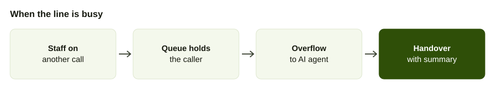

It is 1:15 in the afternoon. The dining room is full, the kitchen has twelve tickets and the phone on the counter is ringing. The cashier is paying a customer. The owner is plating. The call rings out.

That caller, who wanted ten momos for a family lunch, now phones the next restaurant. You never knew.

This guide is about stopping that, without hiring someone just to sit by the phone. If you want to count what you are losing before you change anything, see [how to measure missed calls](/blog/measure-missed-calls-business).

## Why phone orders are missed

Calls arrive when staff are least able to take them. A report from the voice AI company Maple, which analysed 1.2 million calls from over 1,000 US restaurants, found 33 percent of calls unanswered at peak service hours and 68 percent of all calls arriving at lunch and dinner, according to [Maple's own report](https://www.maple.inc/blog/the-state-of-restaurant-phone-communication-insights-from-1-million-calls) (checked October 2026). The same report estimates an unanswered call at about $85 of lost revenue.

Treat those as a US vendor's numbers, not a Nepal measurement. The pattern is probably familiar to you: the busy hour is also the hour with the most calls. Your own phone log will tell you how bad it is.

## A second US data set

Revmo, another US voice AI vendor, analysed 12,091 restaurant call recordings in its State of Restaurant Calls 2026 report. Its findings by segment ([Revmo](https://revmo.ai/news/state-of-restaurant-calls), also reported by [Fast Casual](https://www.fastcasual.com/news/new-study-reveals-revenue-gaps-from-missed-calls/)):

| Segment | Answer rate | Miss rate | Other finding |
| --- | --- | --- | --- |
| Quick service | 59.9% | 40.1% | Estimated $73,000 a year lost per location, Revmo's estimate |
| Fast casual | 75.3% | 24.8% | Wait times up 31% from lunch to dinner |
| Full service | 91.0% | 9.0% | Average hold time of 73 seconds in the segment summary |

Both reports come from vendors who sell phone answering, both are American and neither measured lost orders directly. What they agree on is the shape: the smaller and busier the restaurant, the more calls go unanswered, and the busiest hours are worst. Maple's 33 percent at peak and Revmo's 40 percent for quick service are in the same range, which is why counting your own missed calls for three days is the first step below.

## The four ways a restaurant loses a call

1. **Nobody is free.** Everyone is serving or cooking.
2. **The line is busy.** A second call arrives while the first is being taken.
3. **The order is taken badly.** A shouted order on a noisy line, written on a napkin.
4. **After hours.** Someone calls at 9:30 to ask about tomorrow, and nobody answers.

Each has a different fix.

## The delivery apps in Nepal

Foodmandu, founded in 2010, says it partners with over 1,000 restaurants ([ShareSansar, May 2025](https://www.sharesansar.com/newsdetail/foodmandu-launches-midnight-food-delivery-service-in-kathmandu-2025-05-05)). An earlier Record Nepal piece put the figure at over 800 restaurants across Kathmandu and Pokhara, with over 190 delivery riders ([Record Nepal](https://recordnepal.com/the-business-of-delivering-food)). Most restaurants partner with several platforms, the same article says, so your own phone line competes with apps your customers already have installed.

## Phone orders and delivery apps

Many restaurants also take orders through delivery apps, and the app takes a cut. A Cloud Kitchen MIX operator told Record Nepal that restaurants generally pay about 20 percent of every order, quoting Foodbusters at about 14 to 15 percent, Pathao Food at 18 percent, Bhoj at 20 percent and Foodmandu at about 22 percent ([Record Nepal](https://recordnepal.com/the-business-of-delivering-food)). Foodmandu also takes orders over the phone, according to [Onlinekhabar](https://english.onlinekhabar.com/kathmandu-food-delivery-platforms.html).

A worked example using the quoted rates. On an order of Rs 1,000, an 18 percent commission is Rs 180 and a 22 percent commission is Rs 220, so the restaurant keeps Rs 820 or Rs 780. The same order taken on your own phone line keeps all Rs 1,000, before your own delivery cost. This is arithmetic on Record Nepal's quoted rates, not a measured saving for your restaurant.

A call to your own number carries no commission. That is the case for answering it. If the same customer would otherwise order through an app at 18 to 22 percent, each answered call is worth that much more than the app order.

## Fix 1: let anyone answer

The phone should not be tied to one counter. With AirFone, staff answer from the app or a browser, so the call can be answered on a phone or in a browser on a laptop. Your existing number connects over a SIP line, so the number on the menu and the signboard stays the same.

Set who gets the call. The call can go to a team, such as "front counter", with a queue that picks the longest idle person or goes round robin.

## Fix 2: do not let callers hear a busy tone

A queue holds the caller instead of dropping them. You choose how long, and what happens after. A [call queue](/glossary/call-queue) can pick the longest idle person or go round robin, hold for a maximum wait and then overflow to voicemail, another team or an AI call agent. How to set those limits is in [reducing hold time](/blog/reduce-call-hold-time).

Example setup, not a recommendation from data: ring the counter team, hold the caller for a short time you choose with a short message, then pass to the AI agent.

## Fix 3: answer the common questions properly

An AI call agent can answer in Nepali or English from your own information: the menu, prices, delivery areas, opening hours and whether you take payment on delivery. It hands over to a person with a summary when it cannot help. For the full picture, read the [guide to AI call agents](/blog/ai-call-agent-guide) and [what an agent should never say](/blog/what-ai-call-agent-should-never-say).

Example of what to tell it, using your own information:

- Greet by the restaurant's name.
- Give the menu, prices, delivery areas, opening hours and payment methods you have supplied.
- Say clearly when it does not know, and hand over to staff, who receive a summary.

An order that needs taking, changing or confirming is a job for staff. The agent's role in this post is to answer common questions and keep callers from being dropped, not to run the kitchen.

What it should not do: promise a time you have not set, invent a dish or quote a price you have not given it. If a customer asks for something outside the menu, it should say so and offer a person.

## Fix 4: after hours

When the restaurant is closed, an IVR greeting can say the opening time and voicemail can take a message. An AI call agent can answer questions such as opening hours and delivery areas in Nepali or English from the information you give it. Keep the information the agent uses current, including opening hours and holidays.

## Example: set it up in a week

1. **Day 1: count.** For three days, note every call you missed. A tally on paper is enough.
2. **Day 2: write the answers.** Menu with prices, delivery areas, delivery time, payment, opening hours, holiday hours.
3. **Day 3: decide the order of ringing.** Counter first, then the manager, then the queue, then the agent.
4. **Day 4: set the greeting.** Restaurant name first, then one choice if you need one.
5. **Day 5: test.** Call from outside at a quiet time. Order something. Check what staff receive.
6. **Day 6: test the rush.** Ask three people to call at once.
7. **Day 7: go live, then read.** Staff can read call transcripts. Check the first fifty.

## Example call scripts for the person or agent answering

**Opening.** "Namaste, [restaurant name]. Would you like to order for delivery or pickup?"

**Reading back.** "So that is two plates of momo and one dal bhat set. Is that right?"

**Delivery details.** "Please tell me your name, your phone number and the area with a landmark."

**When you cannot help.** "Let me pass you to someone who can. One moment."

**After hours.** "Namaste, [restaurant name] is closed now. We open at [time]. Please leave your name and number, or call back after we open."

## Handing over to the kitchen

The order is only useful if it reaches the kitchen in a form people can cook from. Decide how: a screen on a tablet, a message to the manager or a printed slip. Whichever you pick, test it at peak with real orders. A supervisor can listen to a live call and take over if an order is going wrong.

## What to watch in the first month

- **Calls answered versus missed.** The first number should rise, the second fall.
- **Orders that needed correction.** Each is a gap in the information you gave the agent.
- **Questions you did not expect.** Add the answers.
- **Time to answer.** Are callers waiting longer than a minute?

[Reading the transcript](/blog/measure-missed-calls-business) of a bad call will tell you what to fix faster than a meeting.

## Keep the information current

The agent can only quote what you have told it. Update the menu when a dish sells out or a price changes. Update delivery areas when a rider is off. Update hours for festivals. A wrong answer from a machine is still your restaurant's wrong answer.

## Common mistakes

- **Putting the only phone at the till.** Move calls to wherever staff are.
- **Letting the line ring out.** Every unanswered call is an order for someone else.
- **Letting an agent guess.** If it does not know, it should say so and hand over.
- **Forgetting regulars.** They call to say "the usual". Tell staff to note their orders so that the next call goes faster.
- **Never testing at the rush.** A setup that works at 3 p.m. may not work at 1 p.m.

## Lunch rush, step by step

Here is an example of how a call could go on a good day. A customer dials at 1:10. The counter team's phones ring and the manager picks up on the app. While they speak, a second call arrives. That caller waits in the queue. After the maximum wait you have set, the call overflows to the AI agent, which answers from the information you gave it and hands over to staff with a summary if it cannot help.

In this example nobody heard a busy tone, and the second caller got an answer or a handover.

Compare the old way, where the second caller hears ringing and may give up. The difference is that the second call has somewhere to go.

## Regulars and repeat orders

Many phone orders come from the same people: the office that orders lunch on Fridays, the family that orders on Saturday night. Keep a note of what they usually order, and tell staff to confirm it back. It makes the call shorter for them and the order more accurate for you.
