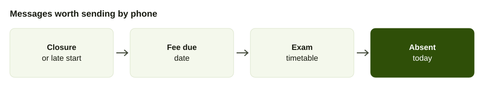
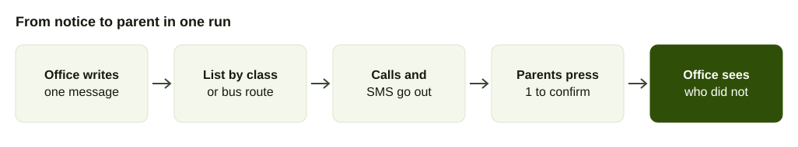

At 6 in the morning, the principal decides to close school because of heavy rain. Within ten minutes, the office has to reach 800 families. Posting on a notice board does nothing, and an SMS is read by some parents after the children are already on the bus.

This is the problem automated calls solve for schools. This guide covers which messages suit a call, how to set a campaign up and how to make sure parents can still reach a person. For the technical background of calling a list, see [bulk voice calls in Nepal](/blog/bulk-voice-call-nepal).

## Messages that suit an automated call

Not everything needs a call. Use a call when the message is urgent, short and needs to be heard today.

- **Closures and late starts.** Rain, strikes, festivals, a bandh.
- **Fee due dates.** A reminder three days before and one on the day.
- **Exam and result dates.** "Terminal exams begin Sunday. Admit cards are at the office."
- **Absence alerts.** "Aarav was not at school today."
- **Event changes.** A parents' meeting moved to Friday.
- **Transport changes.** A bus route changed or running late.

Use SMS or a printed notice for anything parents need to keep: a full timetable, a fee structure or a list of books. A parent can listen to the date on a call, then find the details in the written copy. [Bulk SMS in Nepal](/blog/bulk-sms-nepal) covers the rules and costs of the written side.

## What the call should say

Parents answer unknown numbers reluctantly. Start with the school name, then the message, then what to do.

Example script, poor: "This is an important announcement."

Example script, better: "Namaste, this is [school name]. School is closed tomorrow, Tuesday, because of the strike. Classes resume Wednesday. Press 1 if you heard this message."

Keep it under 30 seconds. Say any date and day of the week together. Repeat the key fact once at the end. Say the school's phone number if you want parents to call back.

## Sending to the right people

A message about Class 5 should reach only Class 5 parents. Build lists by:

- class and section,
- bus route,
- fee status,
- house or hostel,
- staff, for staff notices.

Keep one master sheet with the parent's name, the child's class, the number the parent wants to be called on and a second number if they give one. Update it at admission and each new term, and ask parents to confirm the number at every parents' meeting.

## Getting answers back

A one-way call tells you the phone rang. A call that asks for a reply tells you who heard. There are three levels.

1. **Press a key to confirm.** "Press 1 if you heard this." Simple, and works on every phone.
2. **Press a key to choose.** "Press 1 if your child will take the bus tomorrow, 2 if not."
3. **Speak an answer.** "Please say why Aarav was absent." This suits a few specific questions, and the answers have to be read afterwards.

AirFone's smart bulk calls ask questions and collect the answers into forms, which a school can use for a short parent survey. The same pattern is described in [phone surveys](/blog/customer-feedback-survey-by-phone).

## Setting up a school campaign

1. **Clean the parent list.** Wrong numbers and old numbers waste calls. Remove duplicates, and fix the families who share one phone.
2. **Write the message in plain words.** Name the school, say what has changed and what to do.
3. **Choose the list.** All parents, one class or one route.
4. **Pick the time.** Closures go out as early as the decision. Fee reminders go out mid-morning, not before 9.
5. **Send a small test.** Call three staff phones. Listen for unclear names and dates.
6. **Send the campaign.** For a long list, start with one class so the office phone is not swamped by calls back.
7. **Check who did not answer.** Retry once later in the day. For urgent notices, let the class teacher phone the rest.

## Handle the calls back

Parents will call the number that showed on their screen. If nobody answers, the notice does more harm than good. Plan for that.

- Tell parents which number to call, and make sure it is staffed.
- Use a queue so that parents wait in line instead of getting a busy tone. A queue can pick the longest idle person or go round robin, hold callers for a maximum wait and then overflow to voicemail or another team.
- Let an AI call agent answer common questions, such as whether school is open, in Nepali or English from the information the school gives it, and hand over to staff with a summary when it cannot.
- Use voicemail outside office hours so messages are not lost.

AirFone connects a school's existing number over a SIP line, and staff answer from the app or a browser. See the [call center guide](/blog/call-center-software-nepal) for how queues work in practice.

## What Nepali school software already does

Many schools already have a school app. Sajilo School Manager, built by Eton Technology, tracks attendance and sends urgent notifications to parents through a connected mobile app, with a basic package at Rs 25,000 and a yearly renewal of Rs 15,000, according to [Onlinekhabar](https://english.onlinekhabar.com/man-on-a-mission-to-automate-schools-in-nepal-on-a-budget.html). PDP Spectra's parent app pushes an attendance notification within a minute and sends an absent-student SMS as a fallback for parents without the app, and says SMS is still the right channel for fee and attendance notices for poorer parents ([PDP Spectra](https://pdpspectra.com/solutions/student-experience-nepal)).

The gap that remains is the parent who does not open an app or read an SMS the same hour. A voice call fills that gap for the few messages that cannot wait. It does not replace the school app, and a school can run both.

## What the research says about messaging parents

The best-known trial we found tested text messages, not calls. The US Institute of Education Sciences assigned the families of 26,000 K-5 students in 108 elementary schools across four large urban districts to receive basic attendance messages, or their school's usual communications only, over a full school year, with intensified messages for families whose children kept missing school ([IES](https://ies.ed.gov/use-work/evaluations/impact-evaluation-parent-messaging-strategies-student-attendance)). The evaluation page describes the design and the premise that texting parents is a potentially cost-effective way to improve attendance. We did not find its results on that page, and we did not find a randomised trial of automated voice calls, so this post makes no claim about how much a call changes attendance.

What it supports is the design: a short message, sent to the right parents, with a stronger follow-up for the families who need it. That is how a school should treat calls too.

## Why small schools need cheap tools

The Ministry of Education's Educational Information 2080 BS counts 27,990 community schools in Nepal, of which 15,965, or 57.03 percent, have fewer than 100 students ([Rising Nepal](https://risingnepaldaily.com/news/45592)). A school with under 100 students has a handful of classes and a few hundred phone numbers at most. For that school, one phone line, one list and a short call are a realistic tool, and a full school management system may not be.

## Parent numbers are personal information

Nepal's Individual Privacy Act 2075 lists address, telephone and email address as personal information and restricts using it without the person's consent, per [Pioneer Law's summary of the Individual Privacy Act 2075](https://pioneerlaw.com/individual-privacy-act-2018-2075). Use the numbers parents gave at admission for school business and for nothing else, keep the list with the office and do not share it with outside companies.

## Staying respectful

- Call only the numbers parents gave the school.
- Keep calls for things that matter. Teachers' routine messages go on paper or SMS.
- Call in daytime hours.
- Do not name a child's marks or fee balance in a message that another person could hear. Say "a fee reminder is pending" and leave the amount for the office.
- Offer a way to correct a number or stop calls, and act on it.

## What to measure

After each campaign, note how many calls connected, how many parents confirmed and how many asked for the office. If many parents do not confirm, check the list before changing the message. If many call back with the same question, add the answer to the message next time.

## A first month plan

In week one, clean the list and send one test to staff. In week two, send a low-stakes message such as a parents' meeting reminder. In week three, add a confirm key. In week four, review the replies and decide which messages become regular calls and which stay on paper. Starting with a closure is the wrong way round: a school's first campaign should not be its most urgent one.

## Example: a term calendar

A school that uses calls well tends to settle into a rhythm. At the start of term, a call confirms the numbers on file. Three days before each fee date, a reminder goes out. A week before exams, a call gives the start date and where to collect admit cards. On any closure day, a call goes out as early as possible. After a parents' meeting, a short call thanks those who came and tells the others where to get the notes.

That is five or six calls a term, not one a week. Parents learn that a call from the school means something, and they answer it.
