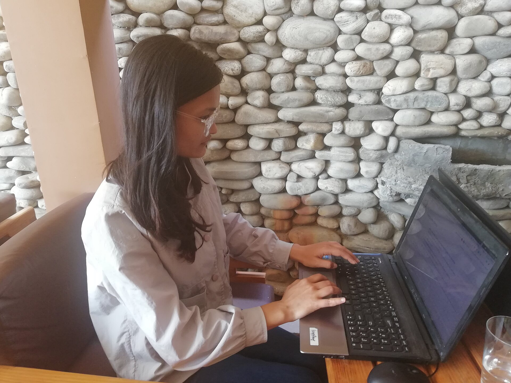

It is nine at night and someone is on your website on their phone. They have been looking at a sofa for twenty minutes. They like it. They are fairly sure they are going to buy it.

They have one question first. Do you deliver to Chitwan?

They check the menu. They scroll to the footer. They open the FAQ page, which answers questions about returns and nothing else. They could send a message through the contact form and wait for a reply tomorrow. Most people will not. They close the tab and look at the same sofa on another site.

That is the gap a website voice agent is for. Not to replace your website, but to answer the one question that stands between a visitor and an order, at the moment they ask it.

## What it looks like for the visitor

A small talk button sits in the corner of your pages. The visitor taps it, their browser asks once for permission to use the microphone, and they simply ask: "Chitwan ma delivery huncha?"

The agent answers out loud, in Nepali, from the information you have given it. Yes, delivery to Chitwan takes three to four days, and cash on delivery is available. If they ask a follow-up, it answers that too. It feels less like using a website and more like ringing the shop, without having to find the number.

## What people actually ask

On shop and service websites, the questions are almost never complicated. They are practical doubts:

Whether you deliver to their city, and how long it takes. Whether cash on delivery is possible. Whether the thing in the photo is actually in stock. What the warranty covers. When the showroom is open if they want to see it first.

Each of these is a small question. Each one is also a reason to leave. A website is good at showing products and bad at answering a specific question in the moment, and that is exactly where most sales quietly go missing.

## From a question to a customer

Answering is only half of it. When a visitor sounds ready to buy, the agent offers to take their name and number so your team can call them back.

The lead arrives with the whole conversation written out. So the next morning your salesperson does not ring and say "How can I help you?" They ring and say "You asked about delivery to Chitwan for the grey three-seater. It is in stock. Shall I book it for Thursday?"

That one sentence is the difference between a callback that feels like a sales call and one that feels like good service.

## How to add it

It takes one line of code, pasted into your website the same way you would add analytics or a chat widget. If you would rather not touch the site yourself, we add it with you.

Then you give it your information: your product pages, price lists, delivery areas and the answers to the questions you hear most. If you already use AirFone on your phone line, there is nothing new to teach. The [website voice agent](/products/website-voice-agent) uses the same knowledge as the phone agent, so a caller and a website visitor hear the same answer.

## Talking, typing, or both

Not everyone wants to speak to a website. In an office, on a bus or late at night next to someone sleeping, typing is easier. The [website chatbot](/products/website-chatbot) uses the same knowledge as the voice agent, so you can offer both and let visitors choose.

For the phone side of the same idea, read [the AI call agent guide](/blog/ai-call-agent-guide). If you are wondering how well it copes with real Nepali speech, [can an AI really speak Nepali on the phone?](/blog/nepali-voice-ai) answers that honestly.
